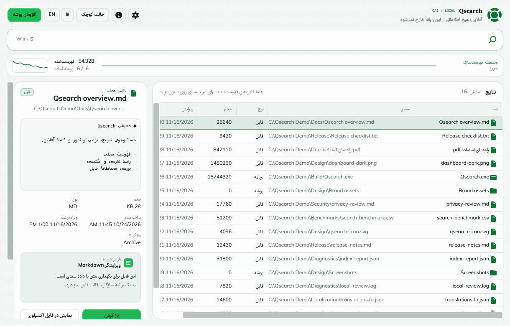
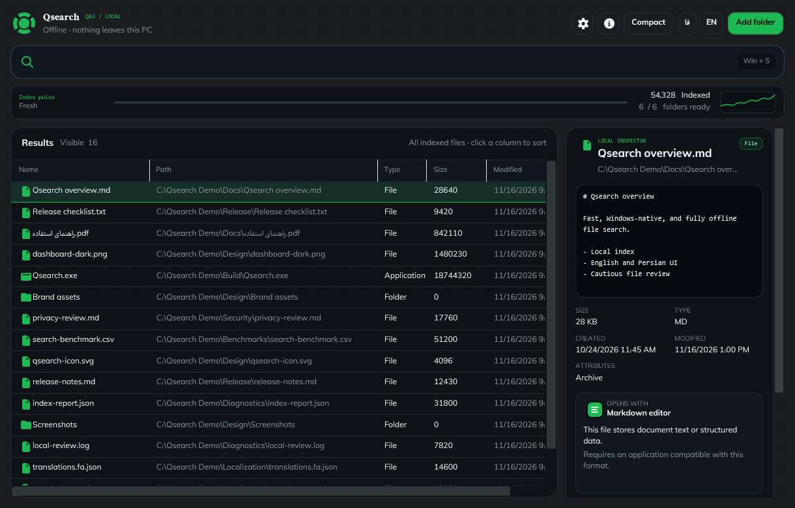

<div align="center" dir="rtl">
  
  <h1>Qsearch</h1>
  <p><strong>جست‌وجوی سریع فایل‌های ویندوز؛ خصوصی از پایه.</strong></p>
  <p>بومی ویندوز · کاملاً آفلاین · فارسی + English · متن‌باز</p>
  <p>
    <a href="README.md">English</a> · <strong>فارسی</strong>
  </p>
  <p>
    <a href="https://github.com/qa3me/qsearch/releases/tag/v0.1.0-preview.1">دریافت نسخهٔ آزمایشی</a>
    · <a href="https://qsearch.qa3.me">صفحهٔ برنامه</a>
    · <a href="SECURITY.md">امنیت</a>
  </p>
</div>

Qsearch فایل‌های موجود روی رایانه را به یک نمای جست‌وجوی محلی، سریع و
مرتب‌شدنی تبدیل می‌کند. رابط بومی و جمع‌وجور ویندوز، جست‌وجوی دوزبانه، دسترسی
از tray و لانچر، فرادادهٔ کاربردی و نشانه‌های محتاطانهٔ بررسی فایل را کنار هم
می‌آورد؛ بدون حساب کاربری، تله‌متری، سرویس ابری، بررسی آپدیت یا کلاینت شبکه در
زمان اجرا.

> **توضیح نسخهٔ آزمایشی**
> نسخهٔ `v0.1.0-preview.1` یک پیش‌انتشار بدون امضای دیجیتال برای ارزیابی است.
> پیش از اجرا SHA-256 را بررسی کنید. ممکن است ویندوز هشدار ناشر ناشناخته نشان
> دهد.

## نمای برنامه

<p align="center">
  
  
</p>

<p align="center"><sub>تصاویر مستقیماً از رابط واقعی WPF و با فایل‌های نمونه ساخته شده‌اند؛ هیچ دادهٔ کاربری در آن‌ها نیست.</sub></p>

## چرا Qsearch؟

| جست‌وجو | بررسی | حفظ حریم خصوصی |
| --- | --- | --- |
| نمای همهٔ فایل‌ها، مرتب‌سازی سریع، یکسان‌سازی حروف فارسی/عربی و فیلترهایی مثل `ext:`، `type:`، `in:` و `risk:`. | پیش‌نمایش، فراداده، برنامهٔ پیش‌فرض، بازکردن/نمایش مسیر و نشانه‌های محلیِ قابل توضیح. | فهرست، عبارت جست‌وجو، تنظیمات، پیش‌نمایش و نتیجهٔ بررسی روی دستگاه می‌مانند؛ بدون تله‌متری یا خروج اطلاعات. |

### ابزارهای روزمره

- پنجرهٔ کامل با تم تیره، روشن و هماهنگ با سیستم.
- پنجرهٔ کوچک tray و لانچر جست‌وجوی سریع در مرکز صفحه.
- انتخاب حالت شروع و میان‌بر <kbd>Win</kbd>+<kbd>S</kbd> هنگام اجرای Qsearch.
- رابط فارسی و انگلیسی با نمایش امنِ چپ‌به‌راست برای مسیر فایل‌ها.
- پیشرفت نرم فهرست‌سازی، نمودار تازگی، اسکرول‌بار اختصاصی و چیدمان واکنش‌گرا
  از عرض ۷۲۰ پیکسل به بالا.

### فهرست‌سازی محلی

- پوشه‌های شخصی بدون نیاز به دسترسی مدیر، محلی فهرست می‌شوند.
- فهرست سریع کل رایانه برای دیسک‌های ثابت NTFS یک گزینهٔ جدا و اختیاری است و
  از helper فقط‌خواندنی با دسترسی بالاتر استفاده می‌کند.
- SQLite FTS، رتبه‌بندی پایدار، نمای ریشهٔ مرتب‌شدنی و همگام‌سازی NTFS journal
  جست‌وجوهای تکراری را سریع نگه می‌دارند.
- برای دامنهٔ محدودتر یا دیسک غیر NTFS می‌توان پوشهٔ دلخواه را انتخاب کرد.

### بررسی محتاطانهٔ فایل

ماژول بررسی فقط شواهد محلی و محدود مانند ساختار فایل، مبدأ ویندوز، ویژگی‌ها و
وضعیت کش‌شدهٔ Authenticode را می‌خواند. هیچ قرنطینه، حذف، آپلود، اعتبارسنجی
ابری یا اقدام خودکاری وجود ندارد و نتیجه **حکم قطعی دربارهٔ سالم یا مخرب بودن
فایل نیست**.

## مرز حریم خصوصی

Qsearch در زمان اجرا کاملاً آفلاین است. نام و مسیر فایل، عبارت جست‌وجو،
پیش‌نمایش، نشانه‌های بررسی، تنظیمات و اطلاعات استفاده هرگز مخابره نمی‌شوند.

حالت کل رایانه نام و مسیر را از فرادادهٔ NTFS می‌خواند. در رایانهٔ مشترک ممکن
است مواردی از نمایه‌های کاربری دیگر یا مسیرهای محدود هم در فهرست محلی دیده
شوند؛ حتی اگر محتوای فایل قابل بازکردن نباشد. این اطلاعات از دستگاه خارج
نمی‌شوند، اما ممکن است برای کسی که از همان حساب ویندوز استفاده می‌کند قابل
مشاهده باشند. اگر این نمایش محلی مناسب نیست، حالت پوشه‌های شخصی/انتخابی را
استفاده کنید. جزئیات در [حریم خصوصی](PRIVACY.md) و
[مدل تهدید](THREAT-MODEL.md) آمده است.

## دریافت و اجرا

یکی از فایل‌های
[`v0.1.0-preview.1`](https://github.com/qa3me/qsearch/releases/tag/v0.1.0-preview.1)
را انتخاب کنید:

| بسته | مناسب برای | پیش‌نیاز |
| --- | --- | --- |
| `Qsearch-0.1.0-preview.1-win-x64-portable.zip` | اجرا از پوشهٔ استخراج‌شده | ویندوز x64؛ Runtime داخل بسته است |
| `Qsearch-0.1.0-preview.1-win-x64-slim.zip` | دانلود کم‌حجم‌تر | ویندوز x64 و ‎.NET 10 Desktop Runtime |

قبل از استخراج، checksum کنار فایل را بررسی کنید:

```powershell
Get-FileHash .\Qsearch-0.1.0-preview.1-win-x64-portable.zip -Algorithm SHA256
Get-Content .\Qsearch-0.1.0-preview.1-win-x64-portable.zip.sha256
```

سپس ZIP را استخراج و `Qsearch.exe` را اجرا کنید. در اجرای اول، فهرست محلی
پوشه‌های شخصی آغاز می‌شود. فقط اگر فهرست سریع کل رایانه را می‌خواهید دکمهٔ
**فعال‌سازی** را بزنید تا پنجرهٔ اجازهٔ ویندوز نمایش داده شود. بستن پنجرهٔ اصلی
برنامه را در tray نگه می‌دارد؛ برای توقف کامل از منوی tray خارج شوید.

برای پاک‌کردن داده‌های محلی Qsearch، ابتدا از برنامه خارج شوید و سپس
`%LOCALAPPDATA%\Qsearch` را حذف کنید. نسخهٔ Portable هم با حذف پوشهٔ
استخراج‌شده پاک می‌شود.

## نمونهٔ جست‌وجو

```text
گزارش پروژه
"یادداشت انتشار" ext:md
type:folder in:documents
installer -backup
risk:review
```

## ساخت از سورس

پیش‌نیازها: ویندوز، PowerShell 7 یا جدیدتر و .NET SDK 10.

```powershell
dotnet restore Qsearch.slnx
dotnet format Qsearch.slnx --verify-no-changes --no-restore
dotnet build Qsearch.slnx -c Release --no-restore -warnaserror
dotnet test Qsearch.slnx -c Release --no-build
```

ساخت و بررسی هر دو بستهٔ بدون امضا:

```powershell
./packaging/build-portable.ps1 -Version 0.1.0-preview.1 -OutputDirectory outputs
./packaging/verify-package.ps1 -Package outputs/Qsearch-0.1.0-preview.1-win-x64-portable.zip
./packaging/build-slim.ps1 -Version 0.1.0-preview.1 -OutputDirectory outputs
./packaging/verify-package.ps1 -Package outputs/Qsearch-0.1.0-preview.1-win-x64-slim.zip
```

راهنمای معماری و توسعه در پوشهٔ [`docs`](docs/) قرار دارد. آزمون کارایی با
رکوردهای مصنوعی اجرا و مشخصات محیط اندازه‌گیری را ثبت می‌کند؛ نتیجهٔ آن ادعای
مقایسه با Everything یا تضمین سرعت روی همهٔ دستگاه‌ها نیست.

## امنیت و محدودیت‌ها

- گزارش آسیب‌پذیری باید به روش نوشته‌شده در [SECURITY.md](SECURITY.md) انجام شود.
- فایل‌های اجرایی این Preview عمداً بدون امضای دیجیتال هستند.
- ویندوز ۱۰ نسخهٔ 22H2 و ویندوز ۱۱ هدف هستند؛ ماتریس کامل دستگاه واقعی، scaling،
  accessibility و سناریوهای مختلف UAC هنوز کامل نشده است.
- پنجرهٔ کوچک یک پنجرهٔ بومی همراه است، نه ارائه‌دهندهٔ Windows Widgets Board.
- مجوزها و اطلاعیه‌های دارایی‌ها در
  [THIRD-PARTY-NOTICES.md](THIRD-PARTY-NOTICES.md) و
  [ASSETS-NOTICE.md](ASSETS-NOTICE.md) قرار دارند.

## سازنده

ساخته‌شده توسط **بهزاد قاسمی / QA3**.

[qa3.me](https://qa3.me) · [qsearch.qa3.me](https://qsearch.qa3.me) ·
[GitHub](https://github.com/qa3me/qsearch)

Qsearch با [مجوز MIT](LICENSE) منتشر می‌شود.
