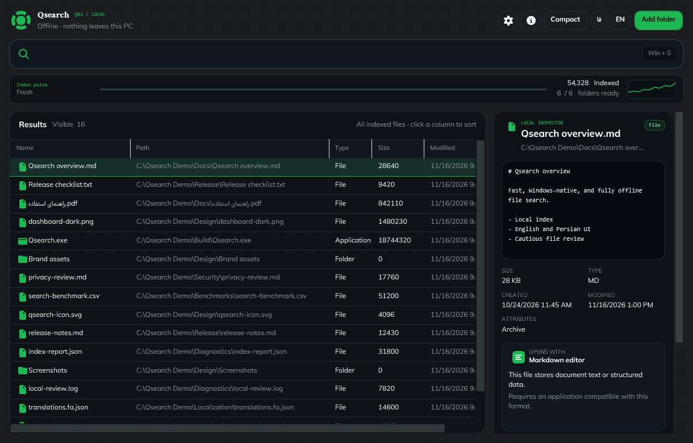
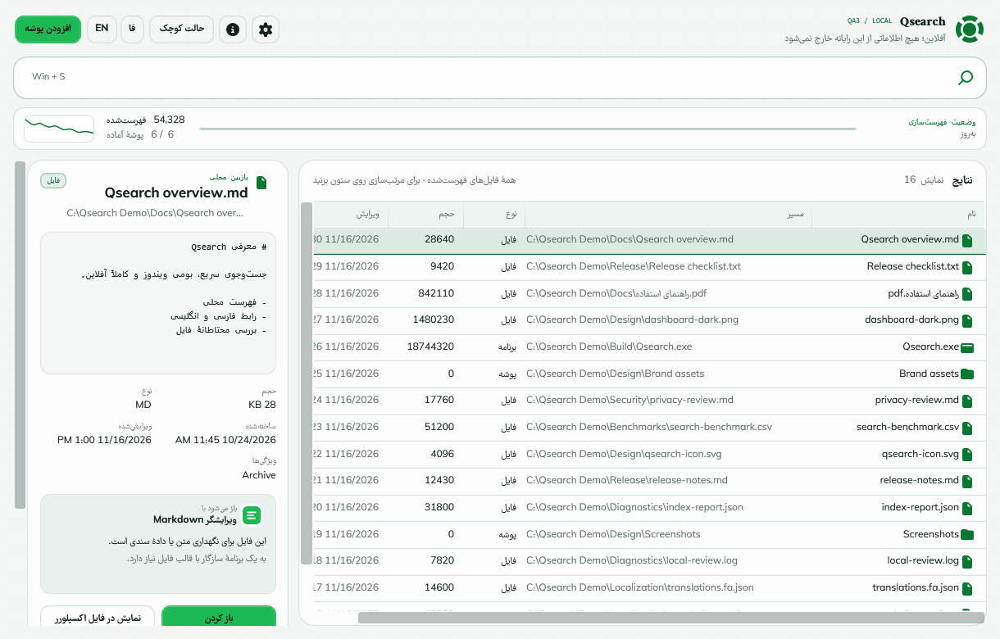

<div align="center">
  
  <h1>Qsearch</h1>
  <p><strong>Fast local file search for Windows — private by design.</strong></p>
  <p>Windows-native · Fully offline · English + فارسی · Open source</p>
  <p>
    <strong>English</strong> · <a href="README.fa.md">فارسی</a>
  </p>
  <p>
    <a href="https://github.com/qa3me/qsearch/releases/tag/v0.1.0-preview.1">Download preview</a>
    · <a href="https://qsearch.qa3.me">Product page</a>
    · <a href="SECURITY.md">Security</a>
  </p>
</div>

Qsearch turns the files already on your PC into a fast, sortable local search
view. It combines a compact Windows-native interface, bilingual search,
tray/launcher access, rich local metadata, and cautious file-review signals —
without an account, telemetry, cloud lookup, update check, or runtime network
client.

> **Preview notice**
> `v0.1.0-preview.1` is an unsigned prerelease for evaluation. Verify its
> SHA-256 file before running it. Windows may show an unknown-publisher warning.

## Product view

<p align="center">
  
  
</p>

<p align="center"><sub>Rendered from the real WPF interface with synthetic demo files. No user data is shown.</sub></p>

## Why Qsearch

| Search | Inspect | Stay private |
| --- | --- | --- |
| Sortable all-files root, instant local queries, Persian/Arabic normalization, and filters such as `ext:`, `type:`, `in:`, and `risk:`. | File preview, metadata, default-app details, open/reveal actions, and explainable local review signals. | The index, queries, settings, previews, and review results stay on the device. No telemetry or data exfiltration. |

### Daily-driver surfaces

- Full desktop window with dark, light, and system themes.
- Compact tray window and centered quick launcher.
- Configurable startup surface and in-process <kbd>Win</kbd>+<kbd>S</kbd>
  shortcut while Qsearch is running.
- English and Persian layout, including safe left-to-right path rendering.
- Smooth index progress, freshness chart, custom scrollbars, and responsive
  layouts from 720 px upward.

### Local indexing

- Personal folders start indexing locally without administrator access.
- Whole-PC fast indexing of ready fixed NTFS volumes is a separate opt-in and
  uses a read-only elevated helper.
- SQLite FTS search, stable ranking, sortable empty-query root, and NTFS journal
  catch-up keep repeated searches responsive.
- Selected-folder crawling remains available for non-NTFS or narrower scopes.

### Cautious file review

The review module reads bounded local evidence such as file structure, origin
metadata, attributes, and cache-only Authenticode state. It is non-destructive:
there is no quarantine, deletion, upload, cloud reputation lookup, or automatic
remediation. It **does not determine whether a file is safe or malicious**.

## Privacy boundary

Qsearch is fully offline at runtime. File names, paths, search terms, previews,
review signals, settings, and usage data are never transmitted.

Whole-PC NTFS mode reads names and paths from volume metadata. On a shared
computer, this can include entries under other Windows profiles or restricted
locations even when their file contents cannot be opened. The index remains
local, but those entries may be visible to anyone using the same Windows
account. Choose personal/selected-folder mode if that local visibility is not
appropriate. See [PRIVACY.md](PRIVACY.md) and
[THREAT-MODEL.md](THREAT-MODEL.md).

## Download and run

Choose an asset from the
[`v0.1.0-preview.1` prerelease](https://github.com/qa3me/qsearch/releases/tag/v0.1.0-preview.1):

| Package | Best for | Requirement |
| --- | --- | --- |
| `Qsearch-0.1.0-preview.1-win-x64-portable.zip` | Run from an extracted folder | Windows x64; .NET runtime included |
| `Qsearch-0.1.0-preview.1-win-x64-slim.zip` | Smaller download | Windows x64 + .NET 10 Desktop Runtime |

Verify the adjacent checksum before extraction:

```powershell
Get-FileHash .\Qsearch-0.1.0-preview.1-win-x64-portable.zip -Algorithm SHA256
Get-Content .\Qsearch-0.1.0-preview.1-win-x64-portable.zip.sha256
```

Then extract the ZIP and run `Qsearch.exe`. On first launch, personal folders
begin indexing locally. Choose **Enable** only if you want the optional
whole-PC fast index and its Windows elevation prompt. Closing the main window
keeps Qsearch in the tray; exit from the tray menu to stop it completely.

To erase local Qsearch data, exit the app and remove `%LOCALAPPDATA%\Qsearch`.
Portable program files are removed by deleting the extracted folder.

## Search examples

```text
project report
"release notes" ext:md
type:folder in:documents
installer -backup
risk:review
```

## Build from source

Requirements: Windows, PowerShell 7+, and .NET SDK 10.

```powershell
dotnet restore Qsearch.slnx
dotnet format Qsearch.slnx --verify-no-changes --no-restore
dotnet build Qsearch.slnx -c Release --no-restore -warnaserror
dotnet test Qsearch.slnx -c Release --no-build
```

Create and verify both unsigned preview packages:

```powershell
./packaging/build-portable.ps1 -Version 0.1.0-preview.1 -OutputDirectory outputs
./packaging/verify-package.ps1 -Package outputs/Qsearch-0.1.0-preview.1-win-x64-portable.zip
./packaging/build-slim.ps1 -Version 0.1.0-preview.1 -OutputDirectory outputs
./packaging/verify-package.ps1 -Package outputs/Qsearch-0.1.0-preview.1-win-x64-slim.zip
```

Architecture and development notes are under [`docs`](docs/). The reproducible
benchmark workload uses synthetic records and reports its measured environment;
it is not presented as an Everything comparison or a universal performance
claim.

## Security and limitations

- Report vulnerabilities privately as described in [SECURITY.md](SECURITY.md).
- Binaries in this preview are intentionally unsigned.
- Windows 10 22H2 and current Windows 11 are targets; the complete physical
  device, scaling, accessibility, same-account UAC, and alternate-administrator
  UAC matrix is not yet complete.
- The compact surface is a native companion window, not a Windows Widgets Board
  provider.
- Third-party and asset notices are in
  [THIRD-PARTY-NOTICES.md](THIRD-PARTY-NOTICES.md) and
  [ASSETS-NOTICE.md](ASSETS-NOTICE.md).

## Author

Created by **Behzad Qasemi / QA3**.

[qa3.me](https://qa3.me) · [qsearch.qa3.me](https://qsearch.qa3.me) ·
[GitHub](https://github.com/qa3me/qsearch)

Qsearch is available under the [MIT License](LICENSE).
